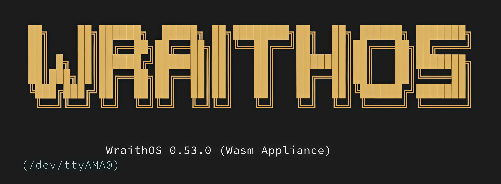

**A Wasm appliance Linux. Single binary, signed boot chain, encrypted data.**

  <code>Rust 1.85+</code> ·
  <code>Wasmtime 48</code> ·
  <code>WASI Preview 2</code> ·
  <code>AGPL-3.0-or-later</code>

  
  
  

---

## What it is

A host binary that runs sandboxed WebAssembly plugins, packaged as a
Buildroot appliance image that boots in under 2 seconds. Two arches,
x86_64 (BIOS + UEFI Secure Boot) and aarch64 (UEFI). A/B rootfs slots
via RAUC, encrypted `/data`, TPM-sealed keys, wizard-driven provisioning.

The runtime alone is a single ~26 MB static-musl binary. It runs the
same on a laptop and on the appliance.

## Why it's worth a look

- **The appliance is small.** 34 MB squashfs rootfs. 640 MB disk image
  includes two rootfs slots, a 256 MB LUKS partition, and the ESP. Most
  minimal Linux distros are 10× larger.
- **Boot chain is verified.** On x86 with Secure Boot enrolled, the
  firmware verifies GRUB, GRUB loads a signed kernel via the EFI stub,
  the kernel boots. Full chain, no Microsoft shim, two small local GRUB
  patches. The threat model and gaps (rootfs tamper at runtime is *not*
  detected; dm-verity on the slot is deferred) are in
  [`docs/security.md`](docs/security.md).
- **TPM sealing is real.** The LUKS keyfile is sealed to PCRs 0-7 under
  a policy that includes the GRUB binary, `grub.cfg`, and Secure Boot
  state. Change any of those, the blob no longer unseals. Plaintext
  keyfile stays as documented recovery path until the operator runs an
  explicit `wraith-tpm-finalize`.
- **Runs the same code you test on your laptop.** `cargo run` in the
  repo gives you the same Axum + Wasmtime host that runs in the
  appliance, without Buildroot or QEMU.

## Quick start (local)

Run the host binary:

    git clone https://github.com/kurohigee07/WraithOS
    cd WraithOS
    cargo run --release

Then in another shell:

    curl -s http://127.0.0.1:9090/healthz

    curl -X POST http://127.0.0.1:9090/modules \
         -H 'x-module-id: hello' \
         --data-binary @modules/default/sample.wasm

    curl -X POST http://127.0.0.1:9090/modules/hello/execute \
         -H 'content-type: application/json' \
         -d '{}'

Full API surface in [`docs/api.md`](docs/api.md). Guest contract, WIT
files, and capability model in [`docs/architecture.md`](docs/architecture.md).

## Quick start (appliance image)

The appliance is not a cloud image. It's a disk image that boots to a
wizard on serial console, then provisions itself from there.

    curl -LO https://github.com/kurohigee07/WraithOS/releases/download/v0.53.1-update-hook/wraithos-x86_64-v0.53.1-update-hook.img

    qemu-system-x86_64 -machine pc -cpu max -m 1024 -smp 2 \
    -drive file=wraithos-x86_64-v0.53.1-update-hook.img,format=raw,if=virtio \
    -netdev user,id=net0,hostfwd=tcp::2223-:22 \
    -device virtio-net-pci,netdev=net0 \
    -serial mon:stdio -no-reboot

On serial console, log in as `root` with `wraithos-admin-change-me`
(documented, intentional, rotate it) and follow the wizard at
`http://127.0.0.1:9090/wizard`. The wizard formats `/dev/vda4` with
LUKS2, seals the keyfile to TPM if present, and gates dropbear until
it completes.

`-cpu max` is required for QEMU. With `-cpu qemu64` (the default), the
guest kernel panics on init because BusyBox uses SSE that qemu64
doesn't expose. This is a QEMU gotcha, not an image bug.

## Architecture

The boot chain is firmware → GRUB (A/B) → signed kernel via EFI stub →
read-only squashfs rootfs → `wraith-init` (Axum + Wasmtime + SQLite +
RAUC healthcheck). `/dev/vda4` is LUKS2 with a TPM-sealed keyfile.

Longer writeup, boot contract details, and A/B rollback semantics in
[`docs/wraithos.md`](docs/wraithos.md).

## What you get

| | |
|---|---|
| **Runtime** | Axum + Wasmtime 48, component model, async host functions, WASI Preview 2 |
| **Sandbox** | Per-module memory limits, per-execution fuel budget, capability-gated HTTP / TCP / DB / log / event |
| **Host** | x86_64 (BIOS / UEFI Secure Boot), aarch64 (UEFI) |
| **Storage** | A/B rootfs via RAUC (health-gated rollback), LUKS2 `/data`, TPM 2.0 seal (PCR 0-7) |
| **Boot** | GRUB, EFI stub, signed kernel on x86 with Secure Boot, no Microsoft shim required |
| **Update** | Signed RAUC bundles, dm-verity transport, trial boot + `/readyz` health gate |

Every one of those has a paper trail. Security model, threat surface,
and known gaps in [`docs/security.md`](docs/security.md). Benchmarks in
[`docs/benchmarks.md`](docs/benchmarks.md) with raw `hey` output in
[`docs/evidence/`](docs/evidence/).

## Status

This is a working engineering project, not a claim of audited
production security. Releases are tagged, changes are documented,
gaps are called out. Recent audit response (11/14 findings fixed, 3
skipped with explicit rationale) is documented in
[`CHANGELOG.md`](CHANGELOG.md) under v0.52.0.

Before deploying to real hardware: read
[`docs/security.md`](docs/security.md), change the default root
password at build time, and understand that the current image is
BIOS-only (v0.50 is the last SB-enabled image; v0.51+ ship BIOS-only
pending the v0.53 per-device SB key rollout).

## Documentation

- [`docs/quickstart.md`](docs/quickstart.md) — 5-minute local + appliance tour
- [`docs/architecture.md`](docs/architecture.md) — guest contract, capability model, WIT
- [`docs/api.md`](docs/api.md) — HTTP API reference
- [`docs/configuration.md`](docs/configuration.md) — `orchestrator.toml`
- [`docs/operations.md`](docs/operations.md) — deploy, update, troubleshoot
- [`docs/security.md`](docs/security.md) — threat model, TPM, Secure Boot, gaps
- [`docs/wraithos.md`](docs/wraithos.md) — appliance internals (boot, RAUC, wizard)
- [`docs/testing.md`](docs/testing.md) — CI, local tests, verification checklist
- [`docs/source-map.md`](docs/source-map.md) — file-by-file map of the repo

## License

Dual-licensed. AGPL-3.0-or-later for open use; commercial license
available for embedding, closed-source SaaS, or warranty terms. See
[`LICENSE`](LICENSE) and [`LICENSE-COMMERCIAL.md`](LICENSE-COMMERCIAL.md).

Third-party components retain their own licenses.
