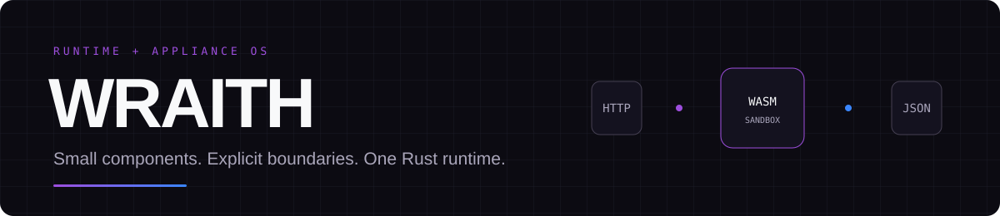

<div align="center">



# Wraith

**A small Rust runtime for sandboxed WebAssembly plugins.<br>An appliance OS for running that same runtime close to the metal.**

[Interactive documentation](docs/index.html) · [Quick start](docs/quickstart.md) · [Architecture](docs/architecture.md) · [API](docs/api.md) · [Security boundaries](docs/security.md)

`Rust 1.85+` · `Wasmtime 48` · `WASI Preview 2` · `Axum` · `SQLite` · `MIT OR Apache-2.0`

</div>

> **Read this first.** Wraith is an ambitious, working engineering project, not a claim of independently audited production security. This documentation follows the source at tag `v0.46.0-health-rollback-fixes` (commit `bfd2da6`), distinguishes measurements from simulations, and calls out unfinished integration paths. Start locally; read [Security](docs/security.md) before exposing an instance to other people.

> **Default root credential.** WraithOS ships with root password
> `wraithos-admin-change-me` for serial console login (ttyS0 on x86,
> ttyAMA0 on ARM) and for the emergency SSH backup (dropbear, port 22
> inside the guest). Change it before exposing the device. Rootfs is
> a read-only squashfs, so password rotation happens at build time by
> editing `/etc/shadow` in the board overlay — see
> [Security](docs/security.md) for the full first-boot checklist.
>
> **SSH pubkey is opt-in.** Step 1 of the wizard accepts an optional
> OpenSSH public key. When one is supplied dropbear starts with `-s`
> and refuses password auth over SSH; serial console keeps
> `/etc/shadow` password auth so a lost key is recoverable from the
> tty. When the field is empty dropbear keeps password auth.
>
> **`/data` encryption.** The first-boot wizard formats `/dev/vda4`
> with LUKS2 and derives the keyfile from the operator-chosen
> encryption password. `/boot/luks.key` is written to the ESP so
> `S30data` can auto-unlock on boot without prompting. If that
> keyfile is lost or corrupt the recovery path is `POST
> /wizard/reset-luks`, which destroys the volume and re-runs the
> wizard — there is no out-of-band recovery key.
>
> **QEMU testing.** `deploy/run-wraithos.sh` and
> `deploy/run-wraithos-arm.sh` run QEMU with `-no-reboot` and a
> restart loop. Guest `reboot` under QEMU TCG leaves corrupted
> serial/tty state; restarting the QEMU process clears it. The
> wrapper hides this from the operator; hardware reboot is unaffected.
>
> **RAUC health gate.** `wraith-install-bundle` (and `wraith-update`
> for the dd path) writes `/data/orchestrator/rauc.pending` on a
> successful install. On the next boot `S99wraith-init` spawns
> `wraith-rauc-healthcheck`, which polls `/readyz` for up to 60 s.
> On `200` it runs `rauc status mark-good` and `wraith-bootenv
> commit`. On timeout it runs `rauc status mark-bad`,
> `wraith-bootenv demote`, and `reboot`, so the GRUB trial counter
> falls through to the last-known-good slot. The timeout branch is
> logged to `/data/orchestrator/healthcheck.log` (LUKS volume) as
> well as syslog, because `/var/log` is a tmpfs and would lose the
> trail across the rollback.

## What is Wraith?

Imagine deploying a small piece of business logic without shipping an entire container image or giving that code unrestricted access to your server.

Wraith accepts a **WebAssembly component**, exposes a narrowly defined set of host functions, and runs its exported `run` function when an HTTP request arrives. The host controls network permissions, execution concurrency, linear-memory limits, and an epoch-based interruption deadline. Execution results are recorded in SQLite and exported as Prometheus metrics.

The repository contains two connected deliverables:

1. **Wraith Orchestrator** — a Rust service combining an HTTP API, Wasmtime, Rhai event rules, an event bus, a dashboard, and a Rust SDK/CLI.
2. **WraithOS** — Buildroot definitions for a minimal Linux appliance that boots the same orchestrator, keeps application data separate from its read-only root filesystem, and supports A/B root filesystem updates.

```text
Your application / curl / Wraith CLI
                 │ HTTP + JSON
                 ▼
┌──────────────────────────────────────────────────────────────┐
│ Wraith Orchestrator                                      │
│                                                              │
│ Axum → authentication → module lookup → quota gates           │
│                                      │                       │
│                                      ▼                       │
│                           Wasmtime component                 │
│                           run(JSON) → JSON                   │
│                                      │                       │
│                 controlled HTTP / TCP / event emission       │
│                                      │                       │
│                         EventBus → Rhai / WebSocket          │
│                                                              │
│ SQLite audit log + Prometheus metrics + embedded dashboard    │
└──────────────────────────────────────────────────────────────┘
                 ▲ the same Rust binary
┌─────────────────────────────────────────────────────────────┐
│ WraithOS: kernel + read-only rootfs A/B + persistent data │
└──────────────────────────────────────────────────────────────┘
```

### Data persistence and encryption

`/data` is the only writable partition. On first boot, before
`/data` is mounted, `S30data` drops into a fallback mode that mounts
a tmpfs over `/etc/wraith` and seeds a default `orchestrator.toml`,
so the wizard is always reachable. Once the operator submits the
wizard with a data-encryption password, `/dev/vda4` is formatted as
LUKS2 (aes-xts-plain64) using a keyfile derived from that password
via argon2, and the keyfile is written to the ESP at
`/boot/luks.key`. Every subsequent boot unlocks the volume with that
keyfile, mounts the ext4 filesystem on the mapper device, and bind
mounts `orchestrator/`, `modules/`, and `wraith/` under `/data`. No
password prompt appears on the console; the boot log shows
`Setting up /data: OK (A/B)` when the unlock succeeded and
`OK (fallback: wizard accessible, /data unmounted)` when it did not.

The wizard also exposes `POST /wizard/reset-luks`, which erases the
LUKS header and clears wizard state. It is the only recovery path
and it is destructive by design: without the derived keyfile the
data on `/dev/vda4` cannot be read.

### Emergency SSH access

Serial console is the primary interface. Dropbear runs on port 22
inside the guest as a second entry point — useful when the operator
is working over a remote hypervisor console that occasionally drops
characters, or when the serial tty is temporarily wedged. Host keys
are ephemeral and regenerated each boot (the rootfs is read-only
and `/data` is under LUKS, so there is nowhere persistent to store
them). The QEMU wrappers forward host ports 2222 (x86_64) and 2223
(aarch64) to guest port 22, so `ssh -p 2222 root@127.0.0.1` works
out of the box.

**SSH authentication modes.** The wizard step 1 accepts an optional
OpenSSH public key. When a key is provided, dropbear starts with
`-s` on every subsequent boot and refuses password authentication;
the key is staged from `/etc/wraith/authorized_keys` into
`/root/.ssh/authorized_keys` (tmpfs) before dropbear starts. When
the field is left empty, dropbear keeps password authentication on
as a convenience for serial-adjacent recovery. **Serial console
remains password-authenticated in both modes** — the Linux
`/etc/shadow` password is independent of dropbear — so a lost SSH
key is recoverable from the serial line without re-flashing.

Dropbear on musl is fragile: the C library ships a `crypt()` stub
that returns `NULL`, so the linker resolves the symbol from the stub
and drops `-lcrypt` via `--as-needed`, which silently breaks
password authentication. Buildroot is patched to force
`ac_cv_search_crypt=-lcrypt`, and `S50dropbear` exports
`LD_PRELOAD=/usr/lib/libcrypt.so.2` as a belt-and-braces guarantee
that the real implementation shadows the stub at runtime.

### Why this project is interesting

| Value | What it means in practice | Source |
|---|---|---|
| **A compact deployment unit** | The Rust service can be cross-compiled as a static musl binary; the ARM overlay includes an AArch64 ELF executable. No Node.js or Python runtime is needed by the service itself. | [Build configuration](Cargo.toml), [operations](docs/operations.md) |
| **A real sandbox boundary** | Guests use linear memory and explicit WIT imports instead of inheriting arbitrary host filesystem access. Host calls pass through capability checks. | [Wasm implementation](orchestrator/src/wasm/module.rs) |
| **Backpressure, not wishful scaling** | Tenant, module, and global concurrency gates bound work. Rate limits use token buckets; waiting for a permit has a timeout. | [Quota implementation](orchestrator/src/quota.rs) |
| **One contract across languages** | WIT defines the guest boundary. The included guest is Rust, but the contract is not inherently Rust-only. | [WIT contract](orchestrator/wit/host-capabilities.wit) |
| **Observable execution** | Audit rows, execution/wait histograms, pool gauges, health checks, and live events make the runtime inspectable. | [Telemetry](orchestrator/src/telemetry.rs) |
| **Runtime + operating system** | The project goes beyond an application server: boot scripts, persistent mounts, image generation, and ARM boot recovery are included. | [WraithOS guide](docs/wraithos.md) |
| **Inspectable trade-offs** | Limits, known gaps, and historical measurements are documented rather than hidden behind a “production-ready” label. | [Security](docs/security.md), [source map](docs/source-map.md) |

## Explore it interactively

GitHub renders Markdown but does not run JavaScript inside a README. The repository therefore includes a **standalone, dependency-free documentation site** alongside the readable guides.

From a local checkout:

```bash
python3 -m http.server 4173 --bind 0.0.0.0
```

Open **http://localhost:4173/docs/**. Alternatively, open `docs/index.html` directly in a browser; the generated site does not need a backend or CDN.

The site includes:

- **Request journey:** step through authentication, quotas, instantiation, guest execution, and response handling; inspect failure scenarios.
- **Concurrency lab:** change pool capacity, service time, arrivals, and wait timeout; watch requests run, wait, or time out.
- **A/B boot lab:** explore the ARM GRUB trial counter and fallback to the last-known-good slot.
- **Benchmark explorer:** switch between linear and logarithmic views without confusing server execution time with client wall time.
- **Full-text guide search**, code copying, and beginner/engineer explanations.

> Labs are deterministic teaching simulations. They do not contact your server, execute Wasm, write disks, or generate benchmark results.

## Measured snapshot — not a universal speed claim

The following is a re-run of the original benchmark, executed on the same host on **2026-11-08 UTC** against the current tree (post-M11 hardening):

| Measurement | Result | Scope |
|---|---:|---|
| Mean recorded Wasm execution | **183.5 µs** | 20 executions after 3 warmups; empty guest returning `{}` |
| Mean global-pool wait | **1.66 µs** | Same 23 executions; sequential requests |
| Client wall time per request | **1.66 ms** | 20 sequential curl invocations on this host |
| Successful executions | **23 / 23** | Audit log verified |
| Cold source build | **not re-run** | Covered by CI pipeline instead |

Original v0.27.1 measurement for comparison (2026-11-04 UTC): execution 180.9 µs, pool wait 1.45 µs, wall 6.10 ms. Execution and pool-wait values are within run-to-run noise (a few percent). Wall time differs because the 2026-11-04 number was collected on a different machine under different load; it is not a regression and not a speedup — it is simply a different host.

The execution timer covers `Store::new`, asynchronous instantiation, `call_run`, and JSON result parsing. It excludes HTTP handling, module lookup, quota acquisition, and audit persistence. Pool wait is a separate timer. Neither number should be inverted into a throughput guarantee.

**About versioning:** the crate manifests declare `0.1.0`; releases are tracked by git tags (`v0.38.0` at the time of this run, current tag `v0.46.0`). The benchmark guest is `tests/fixtures/empty/`, checked in for reproducibility.

[Read the method, raw values, limitations, and reproduction procedure →](docs/benchmarks.md)

## Choose your path

| You want to… | Start here |
|---|---|
| Run your first module locally | [Quick start](docs/quickstart.md) |
| Understand every major runtime component | [Architecture](docs/architecture.md) |
| Write a plugin | [Plugin guide + WIT contract](docs/plugins.md) |
| Integrate over HTTP or Rust | [API reference](docs/api.md), [SDK and CLI](docs/sdk-cli.md) |
| Tune memory, timeouts, tenants, or capabilities | [Configuration](docs/configuration.md) |
| Deploy, back up, restore, and observe | [Operations](docs/operations.md) |
| Evaluate the actual security boundary | [Security and known limitations](docs/security.md) |
| Build or inspect the appliance OS | [WraithOS](docs/wraithos.md) |
| Verify performance claims | [Benchmarks](docs/benchmarks.md) |
| Find the purpose of a repository file | [Complete source map](docs/source-map.md) |
| Contribute or rerun checks | [Testing and contributing](docs/testing.md) |

## Quick start

### 1. Prerequisites

- Linux is the primary target; the deployment scripts also assume Bash, curl, and systemd user services.
- Rust **1.85 or newer**, with Cargo.
- The `wasm32-wasip2` target for building guests.
- For the supplied static-musl deployment path: `cargo-zigbuild`, Zig, and the `x86_64-unknown-linux-musl` target.
- Only if enabling source builds: Bubblewrap, GNU tar, a rustup toolchain, and a pre-fetched Cargo dependency cache.

```bash
rustup target add wasm32-wasip2
cargo build --locked -p orchestrator
cargo build --locked -p sample-plugin --target wasm32-wasip2 --release
```

### 2. Start the service

Run from the repository root so relative paths resolve correctly:

```bash
./target/debug/orchestrator --config orchestrator.toml
```

The supplied configuration binds to `127.0.0.1:9090`. Despite its name, **`metrics_bind` is the listener for the entire API and dashboard**, not just Prometheus.

```bash
curl --fail http://127.0.0.1:9090/healthz
curl --fail http://127.0.0.1:9090/readyz
```

### 3. Execute the included module

The tracked `sample.wasm` calls `example.com` over HTTP and TCP and emits an event. It needs outbound network access; a capability or transport failure can appear inside an HTTP 200 result because the sample catches those guest-side errors.

```bash
curl --fail -X POST \
  http://127.0.0.1:9090/modules/sample/execute \
  -H 'Content-Type: application/json' \
  -d '{"hello":"wraith"}'
```

For a network-free first request, build the minimal guest in the [plugin guide](docs/plugins.md).

### 4. Inspect the result

- Dashboard: `http://127.0.0.1:9090/ui`
- Readiness: `http://127.0.0.1:9090/readyz`
- Metrics: `http://127.0.0.1:9090/metrics`
- Audit: `http://127.0.0.1:9090/audit/logs`

> The dashboard's execute button does not attach a Bearer token, and its event socket hard-codes `ws://`. With authentication enabled or behind HTTPS, use the API/CLI or adapt the embedded UI; see [known limitations](docs/security.md#dashboard-and-wizard).

## The guest contract

Every plugin implements this WIT world:

```wit
world plugin {
    import http;
    import tcp;
    import events;
    export run: func(payload: string) -> result<string, string>;
}
```

The host serializes incoming JSON to a string. The guest returns a string containing valid JSON. A minimal guest can be entirely offline:

```rust
wit_bindgen::generate!({ path: "wit", world: "plugin" });

struct Empty;

impl Guest for Empty {
    fn run(_payload: String) -> Result<String, String> {
        Ok("{}".to_string())
    }
}

export!(Empty);
```

`Component::from_binary` expects a **Wasm component**, not an arbitrary `wasm32-unknown-unknown` core module. See [Plugins](docs/plugins.md) for complete manifests, build commands, capabilities, errors, and event rules.

## API at a glance

| Method | Path | Purpose |
|---|---|---|
| `GET` | `/healthz` | Process liveness; plain text `ok` |
| `GET` | `/readyz` | SQLite query and available global Wasm capacity |
| `GET` | `/metrics` | Prometheus exposition |
| `GET` | `/debug/state` | Modules, pool, sockets, uptime |
| `GET / POST` | `/modules` | List/upload in the default tenant |
| `PUT / DELETE` | `/modules/{id}` | Replace/delete a module |
| `POST` | `/modules/{id}/execute` | Execute with a JSON body |
| `GET / PUT` | `/modules/{id}/quota` | Read/replace module quota |
| `POST` | `/modules/build` | Compile uploaded source; disabled by default |
| `GET` | `/audit/logs` | Latest 50 audit rows across tenants |
| `GET` | `/ui`, `/wizard` | Embedded dashboard and setup UI |
| `GET` | `/ws/events` | Live EventBus stream |

Tenant-specific module routes use `/t/{tenant}/modules…`. Uploads use `X-Module-Id` and optional quota/capability/signature headers. The [API reference](docs/api.md) documents exact payloads, status codes, authentication behavior, and caveats.

## Configuration essentials

```toml
metrics_bind = "127.0.0.1:9090"
modules_dir = "./modules"
db_path = "orchestrator.db"
data_dir = "./data"

max_concurrent_wasm = 2
wasm_acquire_timeout_secs = 10
wasm_memory_limit_mb = 256
max_sockets = 256
http_timeout_secs = 30

require_auth = false
enable_build = false
enable_build_network = false
trusted_signer_keys = []
```

These are development defaults, **not a public-internet hardening profile**. `require_auth=false` leaves tokenless tenants open. A capability header can grant permissions beyond the global fallback; it is not intersected with that fallback. Signature enforcement also has persistence gaps. Read [Configuration](docs/configuration.md) and [Security](docs/security.md) together.

## Repository layout

```text
orchestrator/       Rust host, HTTP API, Wasmtime bridge, Rhai, UI, tests
shared-types/       Manifest, capability, and quota data types
sample-plugin/      Rust guest using HTTP, TCP, and events
wraith-sdk/         Async Rust HTTP client
wraith-cli/         `wraith` command-line application
modules/default/    Checked-in sample component and quota sidecar
deploy/             systemd, backup/restore, packaging, signing, smoke helpers
deploy/wraithos/    x86 and ARM Buildroot trees, boot scripts, RAUC wrappers, Termux helpers
docs/               English guides, benchmark evidence, interactive documentation
HANDOFF.md          Historical development notes; not the current source of truth
TODO.md             Historical planning list; verify against source before using
```

The [source map](docs/source-map.md) covers every file tracked at the documented baseline, including boot overlays, legacy backups, binary artifacts, and generated/vendor files.

## Implementation status and trust

**Present in source:** component execution; HTTP/TCP/event host bridges; lifecycle API; quota gates; tenant configuration; optional global authentication; conditional Bubblewrap source builds; signatures; dashboard/WebSocket; SDK/CLI; first-boot wizard handlers; ARM boot-state/watchdog scripts; RAUC health-gated rollback; release helper scripts.

**Not established by this documentation:** a fresh OS image build, a reproducible benchmark rerun, independent penetration testing, complete tenant isolation, crash-safe update transactions (a health-gated RAUC rollback exists, but power-loss atomicity of the GRUB env write is not proven), or a finished setup-to-login/network/encryption integration.

Some historical notes describe features as planned even though code now exists. Other notes describe successful QEMU runs that cannot be independently verified from this checkout alone. The new guides label those claims explicitly.

## Verification and documentation maintenance

The source contains **23 Rust unit tests and 10 HTTP integration tests**. Some integration paths require access to `example.com`; they are not a hermetic security suite. Rust tests were not run for this documentation-only update because Cargo/Rust is unavailable in the documentation workspace.

The documentation site is static and can be rebuilt with:

```bash
cd docs
npm ci
npm run build
npm start
```

See [Testing](docs/testing.md) for the Rust CI commands, documentation browser checks, and a release verification checklist. No runtime behavior was changed to produce these guides.

## License

Copyright (c) 2026 kurohigee07.

Licensed under either [MIT](LICENSE-MIT) or [Apache License 2.0](LICENSE-APACHE), at your option. Third-party components retain their own licenses; the documentation fonts include their license files in `docs/assets/fonts/`.
