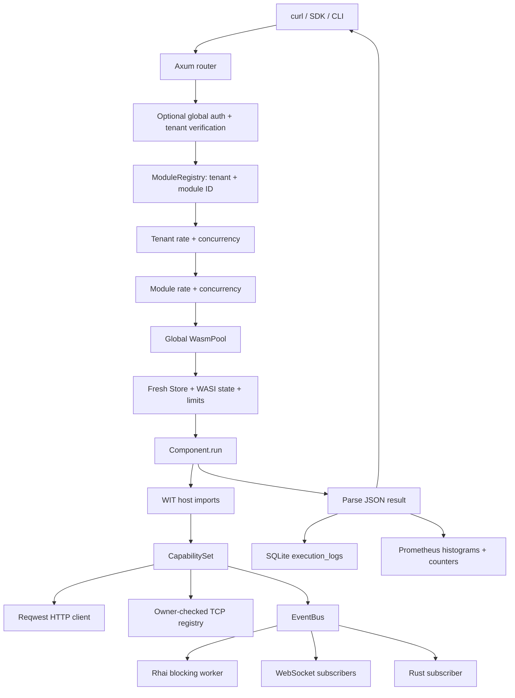

# Architecture: follow a request to the source

This is a source-level description of commit `f71294a`, not an aspirational design document. The interactive request lab simplifies timing for teaching; the sequence below describes the actual code.

## System overview



## Repository boundaries

The Cargo workspace has five members:

- `orchestrator`: library plus thin `main.rs` binary.
- `shared-types`: serializable manifest, capability, and quota types.
- `sample-plugin`: a `cdylib` guest; excluded from default workspace builds.
- `wraith-sdk`: HTTP client, not an embedding of Wasmtime.
- `wraith-cli`: Clap interface over the SDK.

WraithOS is outside the Cargo workspace. It packages a separately cross-compiled orchestrator into Buildroot filesystem overlays.

## Startup sequence

`orchestrator/src/main.rs` performs the following, in order:

1. Parse CLI flags. Load TOML if the selected file exists; otherwise use Rust defaults. Apply CLI overrides for module directory and logging.
2. Initialize tracing. `RUST_LOG` takes precedence over the configured log filter. `--dry-run` exits here.
3. Warn if global Wasm concurrency is at least available CPU parallelism.
4. Install the Prometheus recorder and build a shared Wasmtime engine with component-model and epoch interruption enabled.
5. Start a native epoch ticker thread: one tick every 100 ms.
6. Build `AppContext`: install the ring TLS provider, construct reqwest, open SQLite with WAL, create the audit table, and allocate socket/Wasm registries.
7. Migrate recognized flat module files into `modules/default/`; existing destinations are not overwritten. The destination is literally `default`, even if `default_tenant` has another name.
8. If global authentication is required, verify that the default tenant has a token configured.
9. Resolve Cargo home; if source builds are enabled, require `bwrap --version` to succeed.
10. Construct the tenant registry, validate Argon2 PHC syntax, and load module directories/components/sidecars/signatures.
11. Construct wizard state and the shared `ApiState`; bind the HTTP listener if `metrics_bind` is nonempty.
12. Compile the Rhai AST, subscribe its worker, start a Rust logging subscriber, and publish one `scan.completed` smoke event.
13. Wait for SIGINT/SIGTERM on Unix, then run shutdown cleanup.

There is no startup execution of every module. The old probe was removed to avoid unintended guest side effects.

## Shared state and ownership

`AppContext` is shared through `Arc` and owns:

| Field | Purpose | Lifetime |
|---|---|---|
| `http` | Reqwest client with rustls/ring, webpki roots, no redirects | Process |
| `db` | SQLx SQLite pool | Process; explicitly closed at shutdown |
| `sockets` | Global bounded map of TCP streams | Until closed/released; not automatically scoped to a Store |
| `wasm_pool` | Global semaphore and in-flight gauge | Process |
| `capabilities` | Global fallback policy | Process |
| `event_bus` | Broadcast sender | Process |
| `config` | Effective host resource settings | Process |

A `WasmModule` owns a manifest, shared engine, compiled `Component`, `Linker<WasmHostState>`, quota state, and capability set. It does **not** own a permanently running guest instance.

## The execution path in detail

### 1. Routing and authentication

The single Axum router serves health, metrics, debug state, module lifecycle, UI, WebSocket, wizard, and optionally source builds. A 60-second `TimeoutLayer` wraps the router.

If `require_auth=true`, middleware exempts only exact `/healthz` and `/readyz` paths and verifies the **default tenant's** Bearer token. Module handlers then perform tenant-specific verification again. This is not an RBAC system; read [authentication semantics](security.md#authentication-is-not-tenant-isolation).

Module routes parse JSON before the execution handler runs. The module router applies a 10 MiB body limit. Uploads are raw bytes, not multipart forms.

### 2. Lookup and tenant gates

The registry key is `(tenant, id)`. A missing module produces 404. Execution then:

1. Consumes a tenant rate token, if configured.
2. Acquires a tenant concurrency permit, if configured, with `wasm_acquire_timeout_secs` as the wait limit.

The returned permit is RAII-owned: dropping it releases capacity and updates the tenant gauge.

### 3. Module gates

`WasmModule::execute_quota` consumes a module rate token and then acquires a module concurrency permit. Zero-valued quota fields mean no extra gate at this layer.

Rate-limit rejection is immediate. Concurrency rejection waits up to the configured timeout. These branches update rejection metrics; early tenant rejections do not create execution audit rows.

### 4. Global pool

`WasmPool::acquire` waits for one of `max_concurrent_wasm` permits. The wait is measured separately as `wasm_pool_wait_seconds`. On timeout it returns a capability-denied library error, which the HTTP layer currently maps through the internal-error path to **500**.

Permits are not pre-created Wasm instances. A permit only authorizes work.

### 5. Fresh Store and host state

For every accepted execution, `execute_impl`:

- Chooses the module memory cap, falling back to the global cap when the module value is zero.
- Creates a new `Store<WasmHostState>`.
- Sets an epoch deadline of 600 ticks, approximately 60 seconds at the configured 100 ms tick interval.
- Installs `StoreLimits` with `memory_size` and `trap_on_grow_failure(true)`.
- Creates a fresh WASI context and resource table, inheriting standard I/O but not adding arbitrary filesystem preopens.
- Instantiates the component asynchronously using the compiled component and linker.

This explains why the benchmark explicitly includes Store creation and instantiation. There is no persistent Wasm instance pool.

### 6. Payload, guest call, and result

The conversion is deliberately string-based:

```text
HTTP JSON value
  → serde_json::to_string
  → WIT run(payload: string)
  → guest Result<String, String>
  → serde_json::from_str
  → HTTP JSON value
```

Both sides must honor the JSON convention. Returning arbitrary text such as `hello` is a valid WIT string but fails host JSON parsing. Returning `Ok("\"hello\"")` would produce a JSON string response.

A guest `Err`, trap, instantiation failure, or invalid output JSON becomes an execution error. A host-import error is not necessarily an execution error if the guest catches it and returns valid JSON, as the sample does.

### 7. Audit and metrics

After `execute_impl` completes, the host:

- Records success/error counters.
- Inserts an audit row with integer milliseconds and an optional error string.
- Records execution duration in seconds as a floating-point histogram observation.

The execution timer starts immediately before `execute_impl` and stops before the audit insert and execution-histogram recording. It includes payload serialization and result parsing. It excludes lookup, rate/concurrency acquisition, global-pool waiting, HTTP parsing, and audit writes.

The audit insert ignores its own `Result`: a database write failure does not currently turn a successful guest execution into an HTTP failure. Plan independent database monitoring and backup verification.

## WIT host bridges

The complete contract is in `orchestrator/wit/host-capabilities.wit`.

### HTTP

`http.get(url)` parses the URL, checks the host against exact, wildcard-subdomain, or `*` matchers, and sends a GET through the shared reqwest client. Non-2xx responses become guest-visible errors. Redirect following is disabled.

The matcher checks the hostname, **not the scheme, port, resolved IP, or response size**. The overall reqwest timeout defaults to 30 seconds. An allowlisted hostname that resolves to a private address can still create SSRF exposure.

### TCP

`tcp.connect(host, port)` checks the configured port list, opens a Tokio TCP stream, enables TCP_NODELAY on a best-effort basis, and stores it in the global socket registry. `read`, `write`, and `close` use the returned handle.

The current owner string is the module ID, not `(tenant, module ID)`. Socket handles are not automatically removed when a Store is dropped. Guests should close their handles; the implementation needs stronger execution/tenant scoping for untrusted multi-tenant use.

`CapabilitySet` contains a TCP-host matcher field, but the shared `TcpConnect` type and config expose only ports, so that field is not populated through the current public configuration path.

### Events

`events.emit(kind, payload_json)` checks event-kind permission and parses the payload before publishing:

```json
{
  "kind": "sample.emitted",
  "payload": {},
  "source_module": "sample"
}
```

The bus is a Tokio broadcast channel with capacity 1024 in the main binary. It is in-memory, lossy for lagging receivers, and has no durable replay or tenant partition. A slow WebSocket client or Rhai worker can miss events.

## Rhai event processing

The worker compiles the configured script once. For each non-Rhai event it:

1. Serializes the payload to a string.
2. Creates a fresh Rhai engine inside `spawn_blocking`.
3. Exposes `event_kind`, `event_payload`, `log_info`, and `emit_event`.
4. Runs the shared AST.
5. Drains emitted events and publishes them with source `rhai`.
6. Skips source `rhai` on receipt to prevent immediate self-feedback.

Only `log_info` is gated by the global log capability. Rhai emission is not checked against the Wasm event-kind allowlist. The script is operator-provided trusted code; the current engine has no explicit operation/memory budget or cancellation deadline. `spawn_blocking` moves CPU work off an async worker but is not a security sandbox.

## Registry and disk persistence

A successful raw upload writes:

```text
modules/<tenant>/<id>.wasm
modules/<tenant>/<id>.wasm.quota.json
modules/<tenant>/<id>.wasm.capabilities.json
```

`atomic_write` creates a sibling temporary file, writes, fsyncs, renames, and attempts directory fsync. This makes an individual file replacement atomic; it does **not** make the three-file commit plus in-memory registry update a single transaction.

On startup, directories become tenant names and filename stems become module IDs. Invalid components or signatures are skipped. Missing/invalid sidecars fall back to defaults. An empty capability manifest uses global capabilities at runtime; this means an explicitly empty upload manifest is not a durable deny-all policy.

Hot replacement swaps the registry `Arc`. An execution already holding the previous module finishes against that old object. Delete removes the registry entry and attempts to remove Wasm/quota files, but does not currently remove the capabilities sidecar or signature sibling.

## Build pipeline

When explicitly enabled, `/modules/build` accepts a tar or gzip tar with `Cargo.toml` at the archive root. It extracts into a temporary directory, parses the package name, and runs release compilation for `wasm32-wasip2` through Bubblewrap. A global semaphore permits one build at a time. Cargo has a 300-second timeout; tar write/wait phases have separate 30-second limits.

The sandbox unshares namespaces, binds system/toolchain paths read-only, makes the source directory writable, and uses tmpfs for home/tmp. Network is shared only when explicitly enabled. Offline mode requires dependencies already available in the read-only Cargo cache.

The outer HTTP timeout remains 60 seconds: a long build can outlive the client's HTTP response. Build success does not currently verify/persist a module signature or persist a capabilities sidecar. Treat this as trusted-operator functionality, not an audited public compiler service.

## Health and observability

- `/healthz`: liveness only.
- `/readyz`: `SELECT 1` plus at least one available global Wasm permit; zero loaded modules is acceptable.
- `/debug/state`: global module/pool/socket snapshot, not tenant-filtered.
- `/metrics`: Prometheus recorder output; process-local counters reset on restart.
- `/audit/logs`: latest 50 rows across all tenants; no pagination in the current API.

## Shutdown

On SIGINT/SIGTERM, main signals the Rhai worker, drops its local bus clone, awaits workers, stops the HTTP listener, and closes SQLite. Axum graceful shutdown and SQLx pool closing can wait for work/connection release.

There are cleanup gaps: the Rust event subscriber has no independent stop signal while other bus senders remain alive, TCP streams are not explicitly execution-scoped, and the outer service manager may enforce a shorter deadline. Test shutdown under realistic load rather than assuming every in-flight request drains within a fixed time.

## Design trade-offs for senior readers

- **Fresh Store per call:** simple state isolation and predictable lifecycle, at the cost of instantiation overhead.
- **Shared Engine/Component:** reuse compilation-related host structures without reusing guest linear memory.
- **Semaphore before instantiation:** bound expensive work rather than discovering resource pressure after allocation.
- **Async host imports + synchronous Rhai offload:** different execution models connected by an event contract.
- **Single-process tenancy:** low operational overhead, but not a hostile-tenant security boundary.
- **Filesystem + SQLite rather than a control-plane database:** easy self-hosting, with explicit multi-file consistency and backup limitations.

Continue with [Security](security.md) for the threat model and [Source map](source-map.md) for file-by-file navigation.
