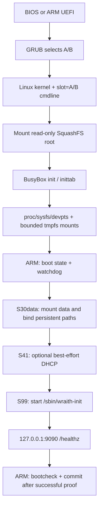

# WraithOS: an appliance around the same Rust runtime

WraithOS is not a second orchestrator implementation. It packages the Rust binary as `/sbin/wraith-init` inside a minimal Buildroot Linux image. The repository contains separate x86_64 and AArch64 external trees with materially different boot/update behavior.

## Start with the architecture split

| Property | x86_64 tree | AArch64 tree |
|---|---|---|
| External tree | `wraithos/br2-ext` | `wraithos/aarch64-br2-ext` |
| Disk layout | MBR/DOS, `genimage.cfg` | GPT, `genimage-arm.cfg` |
| Bootloader | BIOS GRUB, `bzImage` on boot partition | ARM64 EFI GRUB, `BOOTAA64.EFI`, `Image-a/b` on ESP |
| Boot partition | 64 MiB | 200 MiB |
| Root slots | 128 MiB each | 64 MiB each |
| Data partition | 256 MiB ext4 image | 128 MiB unformatted region in current ARM genimage |
| Slot selection | `boot_b` marker, otherwise A | GRUB env trial counter + last-known-good |
| Updater size check | 128 MiB | 60 MiB, leaving headroom below 64 MiB slot |
| Watchdog scripts | Not present in this tree | Present: watchdog, bootcheck, bootenv |
| Runtime init | BusyBox-style overlay; defconfig conflict described below | BusyBox explicitly configured |
| Included host binary | Must be supplied to x86 overlay | Prebuilt AArch64 ELF tracked at `sbin/wraith-init` |

Historical notes report x86 image size 577 MB and ARM image size 458 MB after optimization. Those are **reported artifact sizes**, not sizes rebuilt here. The earlier “18 MB total” headline mixes kernel/rootfs artifacts with a much larger partitioned disk image and should not be used as the full disk size.

## What “immutable” means here

The active root filesystem is SquashFS and ARM GRUB passes `ro`. Application writes are directed to tmpfs and the separate `/data` partition. This reduces accidental rootfs mutation and enables slot replacement.

It does **not** by itself provide cryptographic integrity, verified boot, secure boot, malware resistance, or encryption. A writable boot/data partition remains trusted mutable state.

## Filesystem and boot flow



Persistent mapping when `/data` mounts successfully:

```text
/data/orchestrator → /var/lib/orchestrator  (DB, logs, wizard state on ARM)
/data/modules      → /modules               (components and sidecars)
/data/wraith       → /etc/wraith            (runtime config)
```

The seed config lives at `/etc/wraith.default/orchestrator.toml`. S30data copies it only if persistent config is missing. `fstab` is not the whole story: inittab and init scripts perform the important mounts/bind mounts.

## x86 configuration caveats

The checked-in `wraithos_x86_64_defconfig` selects **systemd**, while the overlay provides BusyBox `/etc/inittab` and S99 scripts. The systemd unit and its absolute symlink are also present, but historical working boot notes describe BusyBox init. This is a source/config mismatch to resolve before claiming a clean reproducible image build.

The file named `wraithos_x86_64_final.config` is only one line setting a download mirror; it is **not a complete final Buildroot configuration**. The x86 defconfig also does not wire the post-image script or host genimage/GRUB tools in the same explicit way as ARM. Treat the x86 build as a reconstructable historical recipe requiring configuration review, not a one-command guaranteed image pipeline.

Hardcoded `/home/opc/...` overlay/fragment paths must be adapted to your checkout. The x86 overlay does not contain the host binary; cross-compile and copy it before building.

## ARM boot contract

`grub-arm.cfg` reads a 1024-byte environment block from `(hd0,gpt1)/grub/grubenv`:

| Variable | Meaning |
|---|---|
| `slot` | Candidate slot for next boot |
| `tries` | Remaining trial boot opportunities |
| `good` | Whether current selection is considered committed |
| `seq` | Monotonic environment revision counter maintained by helper |
| `booted` | Slot GRUB selected for this attempt |
| `lkg` | Last-known-good slot |

Initial post-image values are `slot=A, tries=0, good=1, seq=0, booted=A, lkg=A`.

`wraith-bootenv trial B` sets candidate B, three tries, good=0, and preserves the current slot as LKG. On each trial boot GRUB decrements tries. If attempts reach zero without a commit, a subsequent boot selects LKG. The exact transition sequence is easier to explore in the interactive A/B lab.

After userspace starts, `wraith-bootcheck` verifies:

- Published boot slot and GRUB `booted` agree.
- `/dev/watchdog` exists.
- `wraith-init` process exists.
- Local `/healthz` returns exact `ok`.
- GRUB env is writable.
- If wizard is completed, `/data` and `/var/lib/orchestrator` are mounted.
- A proof file can be created/removed in the data directory.

The watchdog worker pets `/dev/watchdog` every five seconds while proof succeeds or the default 180-second grace period has not expired. On first successful proof it runs `wraith-bootenv commit`. After grace, failed proof triggers demotion, sync, a 20-second wait, and forced reboot. If the process was missing, it attempts restart and treats that cycle as unproven.

This is a meaningful recovery design, but not proof of power-loss atomicity. `wraith-bootenv` overwrites the env file from a runtime temporary file and syncs; it does not implement an A/B environment-block transaction. Hardware/failure injection is still required.

## Updating a root filesystem

**Only run updater commands inside the intended WraithOS guest, as root, after backing up data.** These commands write block devices.

Inspect first:

```sh
cat /proc/cmdline
mount | grep ' / '
ls -l /dev/vda2 /dev/vda3 /dev/vda4
```

ARM:

```sh
wraith-bootenv show
wraith-update /data/candidate-rootfs.squashfs
wraith-bootenv show
reboot
```

After boot:

```sh
cat /proc/cmdline
wget -qO- http://127.0.0.1:9090/healthz
wraith-bootcheck; echo $?
wraith-bootenv show
```

The updater selects the inactive root slot from `slot=A/B`, checks image size, writes with `dd conv=fsync`, syncs, and arms the next boot. It does not cryptographically verify the image. Verify provenance/hash/signature through a separate trusted process before writing.

**Kernel limitation:** ARM `Image-a` and `Image-b` live on the ESP. `wraith-update` writes only rootfs `/dev/vda2/3`; it does not update those kernels. A userspace/kernel compatibility change needs a coordinated kernel update strategy.

### x86 manual marker rollback

x86 GRUB checks only `/boot/boot_b`: present selects B, absent selects A. Its updater toggles `boot_a`/`boot_b` markers but GRUB does not use `boot_a` as a symmetric selector. To return to A:

```sh
rm -f /boot/boot_b
sync
reboot
```

There is no x86 automatic boot-count rollback in this source tree. Do not apply ARM `wraith-bootenv` instructions to x86.

## Building an ARM image from source

This is an outline for an experienced Linux/Buildroot operator, not a verified clean build from this documentation session. Buildroot downloads many external sources and can take substantial time/space.

1. Obtain Buildroot 2024.02.9 from a trusted source and verify its release integrity.
2. Use a separate output directory and copy `wraithos_aarch64_defconfig` into Buildroot's configs.
3. Copy `aarch64-br2-ext` to a stable external-tree path.
4. Edit hardcoded `/home/opc/wraithos-aarch64-br2-ext` paths in the defconfig to that path.
5. Cross-compile the current orchestrator for `aarch64-unknown-linux-musl` and replace the external tree's `rootfs_overlay/sbin/wraith-init` with the new executable. The tracked binary will not update itself from Rust source changes.
6. Review rootfs credential material, config, kernel fragment, and enabled packages.
7. Configure and build with the external tree:

```bash
# Run inside the Buildroot checkout after adapting paths.
export BR2_EXTERNAL="$HOME/wraithos-aarch64-br2-ext"
make O=output wraithos_aarch64_defconfig
make O=output -j"$(nproc)"
```

The ARM defconfig wires `post-build-arm.sh` and `post-image-arm.sh`. Post-build removes selected docs/locales/tooling and unused artifacts; post-image constructs the ESP, GRUB EFI binary/env, kernels, and GPT disk through genimage. Output is expected at `output/images/wraithos-arm.img` when the full pipeline succeeds.

The post-image script writes a textual GRUB env padded with spaces, whereas the runtime helper pads with `#`. GRUB's environment-block format is strict; validate that the generated block loads on the actual GRUB build. Do not assume historical success proves every current script combination is reproducible.

For x86, resolve the init-system/post-image wiring gaps first, supply the binary, and use the BIOS post-image/genimage files as a reference. The repository does not include a full disk image or complete Buildroot output tree.

## Running an image

For an existing x86 image:

```bash
bash deploy/run-wraithos.sh /path/to/wraithos.img
```

The helper uses KVM when writable, otherwise TCG, and attaches the image as virtio. It uses `-nographic -no-reboot`; a guest reboot may terminate QEMU rather than simulate a fresh firmware boot. For A/B tests, restart QEMU explicitly as appropriate.

For ARM, use `qemu-system-aarch64` with a compatible `virt` machine, ARM UEFI firmware, Cortex-A72-compatible CPU, serial console, and the GPT image. The exact firmware path/package varies by host; the repository does not include a complete ARM QEMU launcher. Match `console=ttyAMA0` and virtio disk naming before debugging userspace.

To reach a loopback-only guest API from the host, use QEMU host forwarding, for example a user-mode netdev forwarding host port 9091 to guest 9090. Then access `127.0.0.1:9091` on the host. This does not require binding the guest runtime to every interface.

## First-boot wizard and LUKS

The Rust wizard is present at `/wizard`, not a separate port 8080. It accepts hostname, admin password, optional encryption password, and network settings; writes state under `data_dir`; and records completion markers.

Important boundaries:

- The embedded HTML does not currently expose the encryption-password input.
- Finishing returns `reboot_required:true` but does not itself reboot the machine.
- Persisting an Argon2 hash does not automatically update `/etc/shadow` or orchestrator Bearer config.
- Persisting network TOML does not by itself teach S41network to apply static addressing.
- The backend LUKS path hardcodes `/dev/vda4`, runs `cryptsetup luksFormat`, opens `wraith-data`, and creates ext4. **This destroys existing data on the target.**
- ARM S30data detects LUKS and prompts through cryptsetup before mounting. If no data mount exists it falls back to root/tmpfs paths; do not mistake that fallback for durable persistence.
- The ARM genimage data region is intentionally unformatted in the current layout; historical ext4 images follow a different procedure.

Do not run the encryption endpoint on a development host or populated appliance. Validate in a disposable VM with a known partition layout, a backed-up recovery path, and serial console access.

## Kernel and shell hardening

Kernel fragments enable BPF/JIT, AF_PACKET, cgroups, watchdog/panic behavior, SquashFS, and selected ARM EFI/DM-CRYPT/crypto options. A fragment expresses intent; inspect the final kernel `.config` and booted kernel to confirm dependencies resolved as expected.

ARM inittab/fstab add `nosuid,nodev,noexec` to several writable tmpfs mounts. The shell profile fixes PATH, disables history/core dumps, sets umask/timeout, and makes selected variables readonly. These reduce accidental misuse but do not authenticate the root console or create a sandbox for a compromised root process.

`etc/rauc/system.conf` files and old `post-image.sh.bak` files are historical artifacts. The active updater scripts are custom; do not assume RAUC is installed or manages the boot transaction.

## Verification checklist on real target/VM

- [ ] Correct architecture and boot firmware; expected root slot and `ro` root mount.
- [ ] Persistent data/bind mounts survive reboot and slot switch.
- [ ] Health/readiness and a trusted module execution work.
- [ ] Trial boot commits only after proof; failed trial eventually returns to LKG on ARM.
- [ ] Watchdog behavior and grace period tested with process/HTTP failures.
- [ ] Power-loss behavior tested during update/env rewrite before fleet use.
- [ ] Kernel/rootfs compatibility and update provenance verified.
- [ ] Wizard credentials/network actually applied by the intended image integration.
- [ ] LUKS unlock/reboot tested only on disposable, correctly partitioned storage.
- [ ] Console access and credential material reviewed before distribution.
