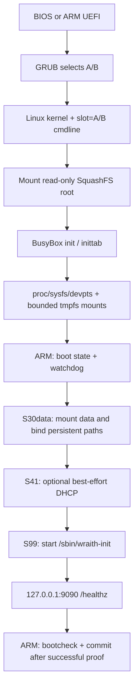

# WraithOS: an appliance around the same Rust runtime

WraithOS is not a second orchestrator implementation. It packages the Rust binary as `/sbin/wraith-init` inside a minimal Buildroot Linux image. The repository contains separate x86_64 and AArch64 external trees with materially different boot/update behavior.

## Start with the architecture split

| Property | x86_64 tree | AArch64 tree |
|---|---|---|
| External tree | `wraithos/br2-ext` | `wraithos/aarch64-br2-ext` |
| Disk layout | MBR/DOS, `genimage.cfg` | GPT, `genimage-arm.cfg` |
| Bootloader | BIOS GRUB, `bzImage` on boot partition | ARM64 EFI GRUB, `BOOTAA64.EFI`, `Image-a/b` on ESP |
| Boot partition | 64 MiB | 200 MiB |
| Root slots | 128 MiB each | 64 MiB each |
| Data partition | 256 MiB ext4 image | 128 MiB unformatted region in current ARM genimage |
| Slot selection | `boot_b` marker, otherwise A | GRUB env trial counter + last-known-good |
| Updater size check | 128 MiB | 60 MiB (wraith-update); RAUC enforces bundle-to-slot fit |
| Watchdog scripts | Not present in this tree | Present: watchdog, bootcheck, bootenv |
| Runtime init | BusyBox-style overlay; defconfig conflict described below | BusyBox explicitly configured |
| Included host binary | Must be supplied to x86 overlay | Prebuilt AArch64 ELF tracked at `sbin/wraith-init` |

Historical notes report x86 image size 577 MB and ARM image size 458 MB after optimization. Those are **reported artifact sizes**, not sizes rebuilt here. The earlier “18 MB total” headline mixes kernel/rootfs artifacts with a much larger partitioned disk image and should not be used as the full disk size.

## What “immutable” means here

The active root filesystem is SquashFS and ARM GRUB passes `ro`. Application writes are directed to tmpfs and the separate `/data` partition. This reduces accidental rootfs mutation and enables slot replacement.

It does **not** by itself provide cryptographic integrity, verified boot, secure boot, malware resistance, or encryption. A writable boot/data partition remains trusted mutable state.

## Filesystem and boot flow



Persistent mapping when `/data` mounts successfully:

```text
/data/orchestrator → /var/lib/orchestrator  (DB, logs, wizard state on ARM)
/data/modules      → /modules               (components and sidecars)
/data/wraith       → /etc/wraith            (runtime config)
```

The seed config lives at `/etc/wraith.default/orchestrator.toml`. S30data copies it only if persistent config is missing. `fstab` is not the whole story: inittab and init scripts perform the important mounts/bind mounts.

## TPM 2.0 sealing (v0.49.0)

The wizard seals `/boot/luks.key` to TPM 2.0 whenever one is present.
The sealed blob is `/boot/luks.sealed.{pub,priv}` (two files, both
needed). Both arches share the same PCR policy.

### Boot-time unseal priority

`/etc/init.d/S30data` resolves `/data` in this order:

1. **TPM unseal.** If both `luks.sealed.pub` and `.priv` exist, run
   `/sbin/wraith-tpm-unseal`, then `cryptsetup luksOpen` with the
   resulting tmpfs keyfile.
2. **Plaintext fallback.** If step 1 did not mount `/data` and
   `/boot/luks.key` exists, unlock with it.
3. **Wizard fallback.** `/data` stays unmounted; the wizard is
   reachable for a fresh setup.

Serial log lines (`Setting up /data: ...`):

| Line | Meaning |
|---|---|
| `TPM unseal OK.` | Sealed path worked |
| `TPM absent, using plaintext keyfile.` | No `/dev/tpmrm0` |
| `TPM unseal failed (rc=N), falling back to plaintext keyfile.` | PCR mismatch or TPM state change |
| `no sealed blob, TPM present but not sealed, using plaintext keyfile.` | TPM device present, sealed blob never created |
| `LUKS keyfile unlock failed.` | Neither path worked; `/data` unmounted |

### PCR policy

Both arches: `sha256:0,1,2,3,4,5,6,7`.

- PCR 0-3: firmware code/config, option ROMs
- PCR 4: GRUB EFI binary
- PCR 5: grub.cfg
- PCR 6: host platform (constant on QEMU virt / SeaBIOS)
- PCR 7: Secure Boot state

Verified stable across cold boots on ARM (edk2 QEMU_EFI.fd) and
x86_64 (SeaBIOS 1.16.3, `-cpu max`). Individual PCR contents were
dumped on ARM only; x86 stability is inferred from successful
seal/unseal across cold boots.

Protects against: disk theft to a different TPM, tampering with the
GRUB EFI binary or grub.cfg on the ESP.

Does NOT protect against: U-Boot FIT measured boot (ARM-specific, no
U-Boot shipped on this image); runtime modification of `/dev/vda2`
or `/dev/vda3` after boot (dm-verity on RAUC bundles covers transport
only); firmware replacement combined with matching PCRs.

### Keyfile finalize policy (v0.49 → v0.53.x)

v0.49 shipped "sealed + plaintext coexist": the plaintext
`/boot/luks.key` was never auto-removed, and an operator had to run
`/sbin/wraith-tpm-finalize` manually. H3 (v0.53.x) closes the
plaintext window: the wizard now calls `wraith-tpm-finalize`
automatically when (a) the TPM seal succeeded and (b) S30data
restart unlocked `/data` from the TPM blob. `finalize` re-verifies
that the sealed blob unseals in the current boot before removing the
plaintext, writes `/boot/.luks-sealed-verified`, and logs a one-way
transition. If the sealed blob does not unseal, `finalize` refuses
and exits non-zero, leaving the plaintext in place. If already
finalized, it is idempotent (exit 0).

Manual `wraith-tpm-finalize` is still the recovery tool for
deployments where the TPM was absent at wizard time, or where an
operator deliberately kept the plaintext (e.g. update window).

Once finalized, run `/sbin/wraith-tpm-prepare-update` **before** any
PCR-affecting operation (kernel/GRUB update, firmware update, RAUC
install that touches `/boot`). It unseals to `/boot/luks.key`
(restoring the plaintext fallback for the update window) and exits
cleanly. After the update and a successful boot, run
`/sbin/wraith-tpm-reseal` to seal under the new PCRs, then optionally
`finalize` again.

### Operator recovery commands

    # Re-seal after a PCR change (plaintext present)
    /sbin/wraith-tpm-reseal

    # Restore plaintext, re-seal, re-finalize (plaintext was removed)
    /sbin/wraith-tpm-prepare-update
    /sbin/wraith-tpm-reseal
    /sbin/wraith-tpm-finalize

    # One-way: remove plaintext after confirming sealed works
    /sbin/wraith-tpm-finalize

    # Verify current state
    ls -la /boot/luks.key /boot/luks.sealed.pub /boot/luks.sealed.priv
    test -f /boot/.luks-sealed-verified && echo finalized
    tail -20 /var/log/wraith-tpm.log

| Symptom | Procedure |
|---|---|
| `TPM unseal OK` every boot | None (normal) |
| `TPM absent` | None; plaintext fallback in use |
| `TPM unseal failed` (plaintext present) | `/sbin/wraith-tpm-reseal` |
| `TPM unseal failed` (plaintext finalized) | `prepare-update` + `reseal` + `finalize` |
| `no sealed blob, TPM present` | `/sbin/wraith-tpm-seal /boot/luks.key` |

### dm-verity and rootfs rescue

v0.53 mounts the rootfs through a dm-verity mapping. The kernel
verifies each block against a Merkle hash tree stored inline in
the same rootfs partition (`rootfs-verity.squashfs`). Any tampered
or corrupted block halts the boot with a kernel panic. `panic=5`
in the cmdline reboots after 5 seconds.

**What triggers a panic:**

- Raw disk tamper of `/dev/vda2` or `/dev/vda3`.
- Silent disk corruption (sector-level bit rot, failing SSD) on
  the active rootfs slot.
- A RAUC bundle that somehow passed signature check but whose
  rootfs content does not match the hash tree in the slot (would
  only happen if the post-image step was skipped on the build
  side).

**Rescue, in order of least invasive:**

1. **Try the other slot.** If the device has a committed
   last-known-good slot on the other side (vda2 vs vda3), it will
   still mount cleanly. Boot it from the GRUB menu and run
   `rauc status` to confirm.
2. **Reinstall via RAUC from a known-good device or rescue
   environment.** The hash tree for the new bundle is generated
   by `post-image.sh` from the new squashfs; installing a fresh
   bundle fixes the slot.
3. **Reflash the disk image.** No data recovery from the tampered
   slot; that is the point. `/data` is a separate LUKS partition
   and is unaffected by dm-verity failures on the rootfs.

**Rebuild the hash tree after intentional rootfs edits:**

If you modify `/dev/vda2` or `/dev/vda3` by hand (unsupported,
but sometimes used in development), the hash tree in that
partition no longer matches the content. The next boot will
panic. Re-run `post-image.sh` on the build side to regenerate
`rootfs-verity.squashfs` and reinstall the image.

**Not covered by dm-verity:**

- ESP tamper (grub.cfg, bzImage, GRUB) on BIOS-only images. The
  hash tree is trusted by origin, not by signature. Tracked as
  v0.53.1 (signed cmdline / signed GRUB config).
- `/data` integrity. LUKS provides confidentiality; it does not
  detect active tampering with the LUKS header or ciphertext.
- Runtime memory tamper through a kernel exploit.

### Kernel/initramfs update procedure (finalized state)

1. `/sbin/wraith-tpm-prepare-update` — restores plaintext.
2. `rauc install bundle.raucb` — bundle updates rootfs slot; `/boot`
   contents survive (ESP is not a RAUC slot).
3. Reboot.
4. `/sbin/wraith-tpm-reseal` — seal under new PCRs.
5. `/sbin/wraith-tpm-finalize` — remove plaintext, set marker.

**Skipping step 1 while plaintext is finalized away and then updating
the kernel will brick `/data` on the next boot.** This is the most
important rule in this section. v0.50.0 automation via a RAUC
bundle-level `hooks.sh` is tracked as roadmap.

## x86 configuration caveats

The checked-in `wraithos_x86_64_defconfig` selects **systemd**, while the overlay provides BusyBox `/etc/inittab` and S99 scripts. The systemd unit and its absolute symlink are also present, but historical working boot notes describe BusyBox init. This is a source/config mismatch to resolve before claiming a clean reproducible image build.

The file named `wraithos_x86_64_final.config` is only one line setting a download mirror; it is **not a complete final Buildroot configuration**. The x86 defconfig also does not wire the post-image script or host genimage/GRUB tools in the same explicit way as ARM. Treat the x86 build as a reconstructable historical recipe requiring configuration review, not a one-command guaranteed image pipeline.

Hardcoded `/home/opc/...` overlay/fragment paths must be adapted to your checkout. The x86 overlay does not contain the host binary; cross-compile and copy it before building.

## ARM boot contract

`grub-arm.cfg` reads a 1024-byte environment block from `(hd0,gpt1)/grub/grubenv`:

| Variable | Meaning |
|---|---|
| `slot` | Candidate slot for next boot |
| `tries` | Remaining trial boot opportunities |
| `good` | Whether current selection is considered committed |
| `seq` | Monotonic environment revision counter maintained by helper |
| `booted` | Slot GRUB selected for this attempt |
| `lkg` | Last-known-good slot |

Initial post-image values are `slot=A, tries=0, good=1, seq=0, booted=A, lkg=A`.

`wraith-bootenv trial B` sets candidate B, three tries, good=0, and preserves the current slot as LKG. On each trial boot GRUB decrements tries. If attempts reach zero without a commit, a subsequent boot selects LKG. The exact transition sequence is easier to explore in the interactive A/B lab.

After userspace starts, `wraith-bootcheck` verifies:

- Published boot slot and GRUB `booted` agree.
- `/dev/watchdog` exists.
- `wraith-init` process exists.
- Local `/healthz` returns exact `ok`.
- GRUB env is writable.
- If wizard is completed, `/data` and `/var/lib/orchestrator` are mounted.
- A proof file can be created/removed in the data directory.

The watchdog worker pets `/dev/watchdog` every five seconds while proof succeeds or the default 180-second grace period has not expired. On first successful proof it runs `wraith-bootenv commit`. After grace, failed proof triggers demotion, sync, a 20-second wait, and forced reboot. If the process was missing, it attempts restart and treats that cycle as unproven.

This is a meaningful recovery design, but not proof of power-loss atomicity. `wraith-bootenv` overwrites the env file from a runtime temporary file and syncs; it does not implement an A/B environment-block transaction. Hardware/failure injection is still required.

## Updating a root filesystem

**Only run updater commands inside the intended WraithOS guest, as root, after backing up data.** These commands write block devices.

Inspect first:

```sh
cat /proc/cmdline
mount | grep ' / '
ls -l /dev/vda2 /dev/vda3 /dev/vda4
```

ARM:

```sh
wraith-bootenv show
wraith-update /data/candidate-rootfs.squashfs
wraith-bootenv show
reboot
```

After boot:

```sh
cat /proc/cmdline
wget -qO- http://127.0.0.1:9090/healthz
wraith-bootcheck; echo $?
wraith-bootenv show
```

The updater selects the inactive root slot from `slot=A/B`, checks image size, writes with `dd conv=fsync`, syncs, and arms the next boot. It does not cryptographically verify the image. Verify provenance/hash/signature through a separate trusted process before writing.

**Kernel limitation:** ARM `Image-a` and `Image-b` live on the ESP. `wraith-update` writes only rootfs `/dev/vda2/3`; it does not update those kernels. A userspace/kernel compatibility change needs a coordinated kernel update strategy.

### RAUC bundle install (recommended)

The primary update path is a signed RAUC bundle:

    wraith-install-bundle /data/arm-v0.46.0-health-rollback-fixes.raucb

wraith-install-bundle wraps rauc install. RAUC verifies the bundle
signature against /etc/rauc/ca.cert.pem, opens the payload under
dm-verity, writes the inactive rootfs slot, and marks the trial via
grubenv. On success it writes /data/orchestrator/rauc.pending.

### Health-gated rollback

Both install paths arm a background health gate on the next boot:

1. S99wraith-init starts the orchestrator as usual.
2. If /data/orchestrator/rauc.pending exists it also spawns
   wraith-rauc-healthcheck.
3. The poller asks http://127.0.0.1:9090/readyz every 2 s for up to
   60 s. /readyz confirms both the HTTP listener and the SQLite
   connection, not just the socket.
4. On 200: rauc status mark-good, wraith-bootenv commit, marker
   removed. Slot committed.
5. On timeout: rauc status mark-bad, wraith-bootenv demote, marker
   removed, reboot. GRUB trial falls through to LKG.

The poller runs in the background, so a slow boot never blocks. It
logs to /var/log/messages and to /data/orchestrator/healthcheck.log.
The /data copy survives the rollback because /var/log is a tmpfs.

Verified end-to-end on ARM with a broken bundle: new slot booted,
timed out at ~70 s, rolled back, rauc status reports it bad.

### x86 manual marker rollback (legacy)

This section documents the pre-RAUC x86 behaviour. RAUC and the
health gate above supersede it. It is kept here for operators
encountering a system where `grub.cfg` still uses `boot_a`/`boot_b`
marker files; the current `grub.cfg` uses `grubenv`.

x86 GRUB checks only `/boot/boot_b`: present selects B, absent selects A. Its updater toggles `boot_a`/`boot_b` markers but GRUB does not use `boot_a` as a symmetric selector. To return to A:

```sh
rm -f /boot/boot_b
sync
reboot
```

There is no x86 automatic boot-count rollback in this source tree. Do not apply ARM `wraith-bootenv` instructions to x86.

## Building an ARM image from source

This is an outline for an experienced Linux/Buildroot operator, not a verified clean build from this documentation session. Buildroot downloads many external sources and can take substantial time/space.

1. Obtain Buildroot 2024.02.9 from a trusted source and verify its release integrity.
2. Use a separate output directory and copy `wraithos_aarch64_defconfig` into Buildroot's configs.
3. Copy `aarch64-br2-ext` to a stable external-tree path.
4. Edit hardcoded `/home/opc/wraithos-aarch64-br2-ext` paths in the defconfig to that path.
5. Cross-compile the current orchestrator for `aarch64-unknown-linux-musl` and replace the external tree's `rootfs_overlay/sbin/wraith-init` with the new executable. The tracked binary will not update itself from Rust source changes.
6. Review rootfs credential material, config, kernel fragment, and enabled packages.
7. Configure and build with the external tree:

```bash
# Run inside the Buildroot checkout after adapting paths.
export BR2_EXTERNAL="$HOME/wraithos-aarch64-br2-ext"
make O=output wraithos_aarch64_defconfig
make O=output -j"$(nproc)"
```

The ARM defconfig wires `post-build-arm.sh` and `post-image-arm.sh`. Post-build removes selected docs/locales/tooling and unused artifacts; post-image constructs the ESP, GRUB EFI binary/env, kernels, and GPT disk through genimage. Output is expected at `output/images/wraithos-arm.img` when the full pipeline succeeds.

The post-image script writes a textual GRUB env padded with spaces, whereas the runtime helper pads with `#`. GRUB's environment-block format is strict; validate that the generated block loads on the actual GRUB build. Do not assume historical success proves every current script combination is reproducible.

For x86, resolve the init-system/post-image wiring gaps first, supply the binary, and use the BIOS post-image/genimage files as a reference. The repository does not include a full disk image or complete Buildroot output tree.

## Building a UEFI Secure Boot x86_64 image

Item 2 (v0.50.0) adds UEFI Secure Boot to the x86_64 image. Signing is
opt-in via `WRAITH_SB_KEYS`. Without it the build produces the legacy
BIOS-only image and prints a loud warning; with it, the image ships a
dual boot chain (BIOS GRUB + UEFI GRUB) and the UEFI path enforces
Secure Boot.

### 1. Generate per-device keys

    export WRAITH_SB_KEYPASS='<long random password>'
    ./deploy/wraithos/uefi/gen-sb-keys.sh ~/sb-keys

Produces `~/sb-keys/{PK,KEK,db}.{key,crt}`. The private keys are
encrypted with `WRAITH_SB_KEYPASS`. **These keys are device-specific.
Do not share between devices. Do not commit them.** Losing `db.key`
prevents future signed updates for the deployed fleet; leaking it lets
an attacker sign images that pass Secure Boot. Confirm encrypted-USB
backups (two copies, different locations) and a password-manager entry
before proceeding in production.

### 2. Build with signing enabled

    export WRAITH_SB_KEYS="$HOME/sb-keys"
    export WRAITH_SB_KEYPASS='<password>'
    make -j4

`post-image.sh` signs `bzImage` and `grubx64.efi` with the db key,
stages them on the ESP alongside the BIOS GRUB (`grub/`) and UEFI GRUB
(`EFI/BOOT/BOOTX64.EFI`), and calls `genimage-efi.cfg` instead of
`genimage.cfg` so the EFI tree is included. Build output is still
`output/images/wraithos.img` (640 MiB).

Without `WRAITH_SB_KEYS` the build produces the legacy BIOS-only
image. This is intentional: dev/CI builds without keys must not fail,
but production builds must set the variable.

### 3. Enroll PK/KEK/db into OVMF for QEMU testing

Signed-image testing uses OVMF with custom keys. Microsoft's default
keys are removed so the firmware verifies only Wraith keys.

    virt-fw-vars \
      --input /usr/share/edk2/ovmf/OVMF_VARS.secboot.fd \
      --output /tmp/wraith-vars.fd \
      --no-microsoft \
      --set-pk 11111111-1111-1111-1111-111111111111 ~/sb-keys/PK.crt \
      --add-kek 22222222-2222-2222-2222-222222222222 ~/sb-keys/KEK.crt \
      --add-db  33333333-3333-3333-3333-333333333333 ~/sb-keys/db.crt

    qemu-system-x86_64 -machine q35 -m 1024 -smp 2 -enable-kvm -cpu host \
      -drive if=pflash,format=raw,unit=0,readonly=on,file=/usr/share/edk2/ovmf/OVMF_CODE.secboot.fd \
      -drive if=pflash,format=raw,unit=1,file=/tmp/wraith-vars.fd \
      -drive file=output/images/wraithos.img,format=raw,if=none,id=disk0 \
      -device virtio-blk-pci,drive=disk0,bootindex=0 \
      -netdev user,id=net0,hostfwd=tcp::2223-:22 -device virtio-net-pci,netdev=net0 \
      -display none -serial file:/tmp/serial.log -no-reboot

`virtio-blk-pci` is required for UEFI boot: the kernel cmdline hardcodes
`root=/dev/vda2` and only virtio block devices appear as `/dev/vda*`.
`ide-hd` presents as `/dev/sda*` and the EFI boot hangs at
`Waiting for root device /dev/vda2...` (the `rootwait` argument makes
that a permanent hang rather than a panic).

Expected UEFI/SB boot on signed image: GRUB menu, then kernel boots,
then `dmesg | grep -i "Secure boot enabled"` returns the line, then
`wraithos login:`.

Expected refusal on stock OVMF (Microsoft keys still in db): firmware
prints `BdsDxe: failed to load Boot0001 ...: Access Denied` and stops.

### 4. Production image rollout

The signed image is not bit-identical to the unsigned BIOS path: the
ESP gains `EFI/BOOT/BOOTX64.EFI` (~730 KiB) and `bzImage` gains a
~1.7 KiB PE signature. Firmware on the target must have PK/KEK/db
provisioned before the first boot of the signed image. Provisioning
is firmware-vendor-specific (usually a Setup menu or an offline var
store write); this document does not prescribe a method.

**Unsigned path stays bootable.** The BIOS GRUB, kernel cmdline, and
squashfs rootfs are unchanged. Non-Secure-Boot hardware boots the
signed image normally through the legacy BIOS path.

### 5. GRUB patches

Two patches under `deploy/wraithos/grub-patches/` are applied to GRUB
at build time:

- `0001-skip-shim-lock-check.patch` — forces the EFI stub loader
  instead of falling back to the legacy loader that requires shim.
- `0002-bypass-shim-lock-verifier.patch` — allows `grub_file_open` on
  the kernel when no shim protocol is present (the kernel has already
  been firmware-verified via `LoadImage`).

Rationale and gap analysis are in `docs/security.md` → "UEFI Secure
Boot (shipped in v0.50.0, x86_64 only)". The patches do not weaken
firmware verification of GRUB or the kernel.

### 6. Certificate migration v0.50.0 -> v0.52+

The v0.50.0 Secure Boot certificate (`db.crt`, fingerprint
`4E:69:FB:25:8E:08:D6:58:D3:53:BB:A7:2F:D0:B1:57:96:5C:25:A9:
AC:E3:64:A9:F6:0A:6C:E3:7F:EA:E8:74`) has no surviving private key
(see `docs/security.md` -> "Build-process post-mortem"). v0.52+ will
ship device-specific keys generated by `gen-sb-keys.sh`. Migrating a
v0.50.0-provisioned device to a v0.52+ image requires replacing the
enrolled `db.crt` in firmware with the new one, because the new image
is signed with a different key.

**This procedure is destructive.** It wipes the disk including the
LUKS `/data` partition. Back up `/data` first (the procedure is the
same as `docs/wraithos.md` -> "Backup before reflash"). There is no
in-place migration path.

**Prerequisites.**

- New v0.52+ image built with your device-specific keys
  (`WRAITH_SB_KEYS=$HOME/sb-keys WRAITH_SB_KEYPASS='...' make -j4`).
- The new `db.crt` file from your `$HOME/sb-keys` directory. Record
  its SHA-256 fingerprint (printed by `gen-sb-keys.sh` on
  completion) alongside the password-manager entry; you will need
  it to verify enrollment succeeded.
- Local backup of the v0.50.0 `/data` partition per the reflash
  runbook.

**Step 1: enter firmware Secure Boot key management.**

On physical hardware this is a Setup-menu item ("Custom Keys",
"Secure Boot DB Management", "Authorized Signatures"). Exact
wording varies by vendor. Consult the board manual before
proceeding.

On QEMU with OVMF:

    virt-fw-vars \\
      --input /usr/share/edk2/ovmf/OVMF_VARS.secboot.fd \\
      --output /tmp/wraith-v0.52-vars.fd \\
      --no-microsoft \\
      --set-pk 11111111-1111-1111-1111-111111111111 ~/sb-keys/PK.crt \\
      --add-kek 22222222-2222-2222-2222-222222222222 ~/sb-keys/KEK.crt \\
      --add-db  33333333-3333-3333-3333-333333333333 ~/sb-keys/db.crt

This produces a fresh varstore that contains only the v0.52+ keys.
The v0.50.0 `db.crt` is not present in the output.

**Step 2: replace the enrolled certificate.**

Two options, depending on what the firmware allows:

*Option A: append the new `db.crt` and remove the old one.*

Most firmware key-management menus accept an append operation. Add
the new `db.crt`, then delete the v0.50.0 entry (identifiable by
the fingerprint above). Until the old entry is removed, an attacker
who somehow has the v0.50.0 private key could boot malicious code;
the key is lost so this is academic, but removing the entry is
hygiene.

*Option B: full replacement via var store rewrite.*

On firmware that only supports full var store replacement (common
on consumer boards), write the new PK/KEK/db over the existing
store. Any keys not in the new store are removed.

**Step 3: verify enrollment before flashing.**

Reboot the v0.50.0 image once. It should still boot if firmware
still trusts its signed `grubx64.efi` (i.e. you have not yet
removed the v0.50.0 `db.crt`). Then boot into the firmware menu
again and confirm the fingerprint of the enrolled `db.crt` matches
your new key's fingerprint (printed by `gen-sb-keys.sh`). If it
does not match, do not flash the new image - firmware will refuse
to boot it.

**Step 4: flash the v0.52+ image.**

Same as the v0.50.0 reflash procedure:

    sudo dd if=wraithos-x86_64-v0.52.0-sb.img of=/dev/sdX bs=4M status=progress conv=fsync

On VPS cloud, provision a new instance from the v0.52+ image or
replace the instance boot disk with the flashed image.

**Step 5: verify boot under Secure Boot.**

    dmesg | grep -i "secure boot"

Expected: at least one line `Secure boot enabled`. If the boot
does not start and firmware prints `Access Denied` at the GRUB
stage, the new `db.crt` is not enrolled correctly - re-enter
firmware and verify the fingerprint.

**Step 6: restore `/data`.**

The wizard on the fresh v0.52+ image will create a new LUKS volume
with a new keyfile. Restore the v0.50.0 `/data` backup into the new
volume:

    cryptsetup luksOpen /dev/vda4 wraith-data
    mount /dev/mapper/wraith-data /mnt
    tar -xzf /path/to/data-v050.tar.gz -C /mnt
    umount /mnt

Keep the v0.50.0 `/backup/*` artifacts (LUKS header, keyfile,
data tarball) for at least 90 days after migration.

**What does not require migration.**

- RAUC bundle updates on the existing v0.50.0 image continue to
  work. They write to the rootfs slots and never touch the ESP,
  so the v0.50.0 signature remains valid under the enrolled
  v0.50.0 `db.crt`.
- A v0.50.0 device that is not reflashed remains usable with
  RAUC-only updates indefinitely. Certificate migration is
  required only when you switch to a v0.52+ *image* (fresh
  deploy, disk replacement, or fleet reflash).

**Deferred:** hardware-validated migration steps on physical
boards. All procedures above are QEMU-OVMF-verified; the
board-specific Setup menu navigation is not tested on real
hardware. Validation is tracked with the v0.52 hardware work.


## Running an image

For an existing x86 image:

```bash
bash deploy/run-wraithos.sh /path/to/wraithos.img
```

The helper uses KVM when writable, otherwise TCG, and attaches the image as virtio. It uses `-nographic -no-reboot`; a guest reboot may terminate QEMU rather than simulate a fresh firmware boot. For A/B tests, restart QEMU explicitly as appropriate.

For ARM, use `qemu-system-aarch64` with a compatible `virt` machine, ARM UEFI firmware, Cortex-A72-compatible CPU, serial console, and the GPT image. The exact firmware path/package varies by host; the repository does not include a complete ARM QEMU launcher. Match `console=ttyAMA0` and virtio disk naming before debugging userspace.

To reach a loopback-only guest API from the host, use QEMU host forwarding, for example a user-mode netdev forwarding host port 9091 to guest 9090. Then access `127.0.0.1:9091` on the host. This does not require binding the guest runtime to every interface.

## First-boot wizard and LUKS

The Rust wizard is present at `/wizard`, not a separate port 8080. It accepts hostname, admin password, optional encryption password, and network settings; writes state under `data_dir`; and records completion markers.

**SSH is closed until the wizard completes (v0.51+).** `S50dropbear`
refuses to start until `/var/lib/orchestrator/wizard.complete`
exists. Reach the wizard over the serial console (default root
password documented in README); `finish_handler` restarts
`S50dropbear` at the end of the same wizard run, so port 22 becomes
available without a reboot. Pre-v0.51 images started dropbear at
boot, which exposed the documented default password on port 22
before the operator had provisioned anything; v0.51 closes that
window. See `docs/security.md` -> "SSH authentication" for the
rationale and CHANGELOG v0.51.0 for the attack window description.

#### Wizard reset-luks recovery (destructive)

`POST /wizard/reset-luks` runs `cryptsetup luksErase /dev/vda4`,
which is irreversible: the LUKS header on `/dev/vda4` is removed,
including the slot that holds the keyfile derived from the wizard
encryption password. This is the last-resort recovery path when
`S30data` cannot mount `/data` (for example: TPM cleared on a
v0.49 device whose plaintext keyfile was removed by
`wraith-tpm-finalize`, or a LUKS header damaged by disk failure),
because a non-mounting `/data` means the wizard marker is not
visible and the wizard state is re-initialized to "first boot".

**As of the 2026-11-14 security batch** the endpoint requires a
confirmation header:

    curl -X POST \
      -H 'X-Wizard-Confirm: I-understand-data-loss' \
      http://127.0.0.1:9090/wizard/reset-luks

Without the header, the endpoint returns `400 Bad Request` and
does nothing. The handler still refuses if `/data` is currently
mounted (`409 Conflict`). After a successful erase an `audit`
event is logged with `event = "wizard.luks_erase"` so the action
is visible in the orchestrator log.

**This wipes `/data` permanently.** Back up the LUKS header and
any data first (see "Backup before reflash" above). The
`/boot/luks.key` file is also removed. Only serial console access
is required to invoke the endpoint (any local user, or remote
access to `metrics_bind` if it was set to `0.0.0.0`); no token is
required because `require_auth` defaults to `false`. The
confirmation header is a speed bump, not authentication. Do not
set `metrics_bind = 0.0.0.0` on a production device with
`require_auth = false`.

Important boundaries:

- The embedded HTML does not currently expose the encryption-password input.
- Finishing returns `reboot_required:true` but does not itself reboot the machine.
- Persisting an Argon2 hash does not automatically update `/etc/shadow` or orchestrator Bearer config.
- Persisting network TOML does not by itself teach S41network to apply static addressing.
- The backend LUKS path hardcodes `/dev/vda4`, runs `cryptsetup luksFormat`, opens `wraith-data`, and creates ext4. **This destroys existing data on the target.**
- ARM S30data detects LUKS and prompts through cryptsetup before mounting. If no data mount exists it falls back to root/tmpfs paths; do not mistake that fallback for durable persistence.
- The ARM genimage data region is intentionally unformatted in the current layout; historical ext4 images follow a different procedure.

Do not run the encryption endpoint on a development host or populated appliance. Validate in a disposable VM with a known partition layout, a backed-up recovery path, and serial console access.

## Kernel and shell hardening

Kernel fragments enable BPF/JIT, AF_PACKET, cgroups, watchdog/panic behavior, SquashFS, and selected ARM EFI/DM-CRYPT/crypto options. A fragment expresses intent; inspect the final kernel `.config` and booted kernel to confirm dependencies resolved as expected.

ARM inittab/fstab add `nosuid,nodev,noexec` to several writable tmpfs mounts. The shell profile fixes PATH, disables history/core dumps, sets umask/timeout, and makes selected variables readonly. These reduce accidental misuse but do not authenticate the root console or create a sandbox for a compromised root process.

`etc/rauc/system.conf` files and old `post-image.sh.bak` files are historical artifacts. The RAUC integration is active since v0.42.1. /etc/rauc/system.conf is used by RAUC to manage the A/B slot state on both arches. wraith-update (the dd path) coexists as a lower-level writer that now arms the same health gate.

## Verification checklist on real target/VM

- [ ] Correct architecture and boot firmware; expected root slot and `ro` root mount.
- [ ] Persistent data/bind mounts survive reboot and slot switch.
- [ ] Health/readiness and a trusted module execution work.
- [ ] Trial boot commits only after proof; failed trial eventually returns to LKG on ARM.
- [ ] Watchdog behavior and grace period tested with process/HTTP failures.
- [ ] Power-loss behavior tested during update/env rewrite before fleet use.
- [ ] Kernel/rootfs compatibility and update provenance verified.
- [ ] Wizard credentials/network actually applied by the intended image integration.
- [ ] LUKS unlock/reboot tested only on disposable, correctly partitioned storage.
- [ ] Console access and credential material reviewed before distribution.

## Update flow (v0.53.1+)

Two paths, both work on dm-verity images:

### RAUC bundle (preferred)

    wraith-install-bundle /path/to/bundle.raucb
    reboot

Sequence: RAUC copies to inactive slot -> post-install handler
`wraith-verity-rehash` recomputes verity tree + rewrites grub.cfg entry ->
`wraith-bootenv trial <other>` -> reboot -> healthcheck polls `/readyz` 60s
-> `rauc status mark-good --override-boot-slot=<booted>` + commit -> done.

Failure path: healthcheck timeout -> `mark-bad` + `wraith-bootenv demote`
-> reboot into last-known-good.

### Raw squashfs (advanced)

    wraith-update /path/to/rootfs.squashfs
    reboot

Same rehash+rewrite but bypasses RAUC bundle signing. Only for
lab/debug — production should use signed bundles.

### Pre-0.53.1 images

Not supported. Flash full image over USB. The v0.53 guard existed
because there was no hook yet.

### Verify after update

    rauc -c /etc/rauc/system.conf status --override-boot-slot=A

`Booted from: rootfs.1 (B)` confirms slot switch.
`grep dm-mod.create /boot/grub/grub.cfg` — slot A hash unchanged,
slot B hash different from A (recomputed).
